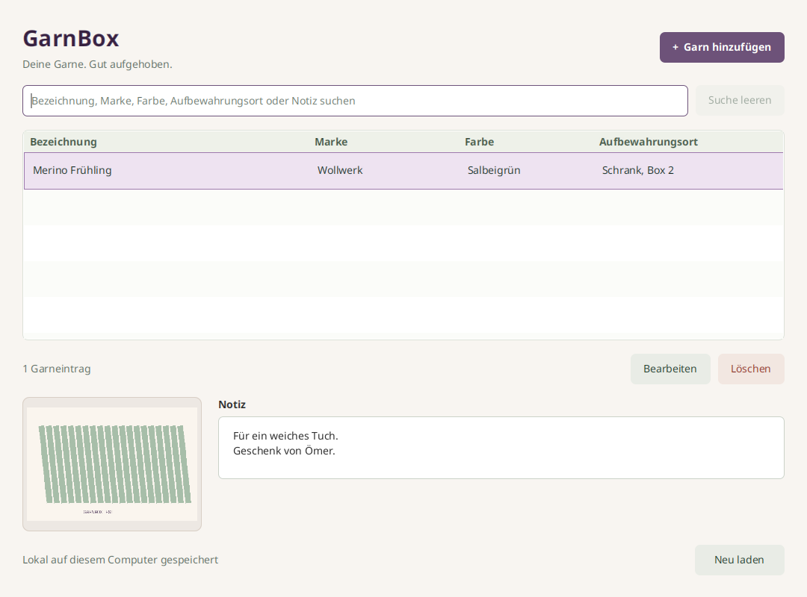

# GarnBox

Deine Garne an einem Ort. Erfasse Bezeichnung, Marke oder Hersteller, Farbe,
Aufbewahrungsort und eine mehrzeilige Notiz. Ein optionales Foto hilft beim
Wiedererkennen. Alles bleibt lokal und nach einem Neustart erhalten.



GarnBox ist Stufe 2 der Java-Reihe nach BücherRegal. Neu ist genau ein Foto pro
Eintrag. Status, Checklisten, Mengenverwaltung, PDF und Cloud gehören nicht dazu.

## Starten

Build und CI verwenden Eclipse Temurin 21.0.13+9. Maven prüft Hersteller,
Version und Buildnummer. Für direkte Maven-Aufrufe auf diesem Rechner:

```bash
export JAVA_HOME="$HOME/.local/share/garnbox/jdk-21.0.13+9"
export PATH="$JAVA_HOME/bin:$PATH"
```

Entwicklung mit einem vollständigen JDK 21. `JAVA_HOME` zeigt auf das JDK,
`PATH` enthält dessen `bin`-Verzeichnis. Der Maven Wrapper lädt Maven und die
Abhängigkeiten beim ersten Aufruf. Die fertige App arbeitet offline.

Linux und macOS aus `garnbox/`:

```bash
./mvnw javafx:run
```

Windows PowerShell:

```powershell
.\mvnw.cmd javafx:run
```

Im vorhandenen Linux-Workspace genügt `./scripts/run.sh`. Der Helfer findet
bei fehlendem `JAVA_HOME` auch das JDK unter `$HOME/.local/share/garnbox/jdk-21.0.13+9`.
Das gebaute Linux-App-Image startet ohne separat installiertes Java:

```bash
./target/app-image/GarnBox/bin/GarnBox
```

## Bedienung

„Garn hinzufügen“ öffnet denselben Dialog wie „Bearbeiten“. Nur die Bezeichnung
ist erforderlich. Gleichnamige Einträge sind unabhängig. Die Suche berücksichtigt
alle fünf Textfelder, Groß- und Kleinschreibung sowie Umlaute. Eine leere Suche
zeigt die ganze Sammlung. Löschen fragt vorher nach.

Die Farbe wird über einen Farbwähler ausgewählt. In der Liste erscheinen ein
Farbfeld und der gespeicherte Hexwert. Eigene Farben lassen sich über den
Farbdialog bestimmen. „ד entfernt die Auswahl. Die Farbe bleibt optional.
Vorhandene Farbbeschreibungen bleiben lesbar und werden erst durch eine bewusste
Farbauswahl oder das Entfernen ersetzt. Eine reine Bearbeitung anderer Felder
bewahrt diese alten Angaben. Die Suche berücksichtigt auch Hexwerte.

Das ausgewählte Foto wird als eigene Kopie in der lokalen SQLite-Datenbank
abgelegt. Verschieben oder Löschen des Originals beeinflusst diese Kopie nicht.
JPEG und PNG werden anhand des Bildinhalts geprüft. Erlaubt sind maximal
10 MiB (10.485.760 Bytes), 6000 Pixel je Seite und 16 Millionen Pixel insgesamt.
Ein zu großes oder ungültiges Foto verändert den bisherigen Entwurf nicht.

Die Fotoauswahl merkt sich ab der nächsten bestätigten Dateiauswahl den
zuletzt verwendeten Ordner für alle Einträge, auch nach einem App-Neustart.
Abbrechen der Dateiauswahl behält den bisherigen Ordner bei. Ist der gemerkte
Ordner nicht erreichbar, beginnt die Auswahl im Bilderordner oder, falls auch
dieser fehlt, im Benutzerordner. Unter Linux wird der konfigurierte
XDG-Bilderordner berücksichtigt. Die Einstellung liegt in `photo-directory.txt`
im App-Datenordner und gehört nicht zum Sammlungsexport. Das Abbrechen eines
Garnentwurfs setzt diese allgemeine Ordnereinstellung nicht zurück.

Abbrechen der Dateiauswahl verändert nichts. Abbrechen des Eingabedialogs,
Escape und Fensterschließen fragen bei ungespeicherten Änderungen nach.
Nach Speicherfehlern bleiben Texte und gewählte Vorschau zum erneuten Speichern
erhalten. Während Bildprüfung und Speichern wartet der Dialog auf den Abschluss.

## Sammlung exportieren und importieren

„Exportieren“ schreibt die gesamte gespeicherte Sammlung in eine JSON-Datei,
einschließlich Bezeichnung, Marke, Farbe, Aufbewahrungsort, Notiz und Fotos.
Die aktuelle Suche und Auswahl begrenzen den Export nicht. Die Dateiauswahl
schlägt einen Namen mit Datum und Uhrzeit vor. Vorhandene Dateien werden
bewahrt. Für einen weiteren Export einen neuen Dateinamen wählen.

Gewählte Farben stehen im Feld `color` als `#RRGGBB`, bei Transparenz als
`#RRGGBBAA`. Eine fehlende Farbe ist eine leere Zeichenfolge. Frühere
Farbbeschreibungen bleiben als ursprünglicher Text erhalten. Das Format heißt
`yarn-box.collection`, Version 1. `photoBase64` enthält die Originalbildbytes
als Base64 oder `null`, wenn kein Foto vorhanden ist. Der Export wird lokal
erst nach vollständigem Schreiben veröffentlicht. Die Datei ist unverschlüsselt.

„Importieren“ steht direkt neben „Exportieren“. Wähle einen zuvor erzeugten
Yarn-Box-Export. Die App ergänzt die Einträge einschließlich Farben, Notizen
und Fotos in der vorhandenen Sammlung. Vorhandene Einträge werden nicht
überschrieben. Bereits vorhandene identische Kopien werden übersprungen.
Gleichnamige Einträge mit anderen Inhalten bleiben eigenständig. Enthält der
Export mehrere identische Einträge, bleibt ihre Anzahl beim Wiederherstellen
erhalten. Ein wiederholter Import derselben Datei erzeugt keine weiteren Kopien.

Nach dem Import zeigt die App die Anzahl hinzugefügter und bereits vorhandener
Einträge und leert einen aktiven Suchfilter. Fehlerhafte Dateien oder Fotos
führen zum Abbruch des gesamten Imports. Die vorhandene Sammlung und die
Quelldatei bleiben dabei unverändert. Importgrenzen sind 256 MiB je JSON-Datei,
10.000 Einträge und 1.048.576 Zeichen je Textfeld. Für Fotos gelten dieselben
Größen- und Formatgrenzen wie bei der Fotoauswahl. Sprache und gemerkter
Fotoordner werden nicht importiert.

## Tastenkürzel

| Taste | Aktion |
| --- | --- |
| Strg+N / Cmd+N | Garn hinzufügen |
| Strg+F / Cmd+F | Suche auswählen |
| Enter oder Doppelklick in der Liste | Ausgewählten Eintrag bearbeiten |
| Entf in der Liste | Nach Bestätigung löschen |
| Strg+S / Cmd+S | Dialog speichern |
| Escape | Dialog abbrechen, gegebenenfalls mit Rückfrage |
| Enter im Notizfeld | Neue Zeile |
| Tab / Umschalt+Tab | Steuerelemente wechseln |

## Sprachen und Store-Vorschau

Die Oberfläche ist auf Deutsch, Englisch, Spanisch, Französisch, Italienisch
und Portugiesisch (Brasilien) verfügbar. Über „Sprache“ eine feste Sprache oder
die Systemsprache wählen und GarnBox neu starten. Die Wahl steht in
`language.txt` im Datenordner. Garne und Fotos bleiben dabei unverändert.
Nicht unterstützte Sprachen verwenden Englisch.

Die [Internationalisierungsanleitung](docs/internationalization.md) beschreibt
die sechs Store-Textfassungen, eigene Icons und 24 echte Linux-Vorschau-Bilder.
Die Lieferung erfolgt als Ordner ohne ZIP. Die native Windows-Abnahme folgt
separat. Die Dateiauswahl verwendet teilweise Beschriftungen des Betriebssystems.

## Datenschutz und Fokusrahmen

„Info“ öffnet die vollständige Datenschutzerklärung offline in der ausgewählten
App-Sprache. Der Dialog ist scrollbar, schreibgeschützt und kopierbar.
Escape oder „Schließen“ führen zurück. Er wird erst nach der Positionierung
sichtbar, damit die anfängliche Korrektur der Fensterposition verborgen bleibt.
Die Erklärung beschreibt die tatsächlich gespeicherten Texte, Fotos und die
jeweiligen Projektfunktionen. Originalfotos werden nicht verändert.

Löschschaltflächen erhalten einen roten Fokusrahmen. Die übrigen Schaltflächen
behalten die jeweilige App-Farbe. Die Auswahlfläche der Tabelle bleibt sichtbar,
der zusätzliche Rahmen der fokussierten Tabellenzeile ist transparent.

Die sechs identischen Texte für Partner Center lassen sich aus den Ressourcen
in einen neuen Ausgabeordner exportieren:

```bash
./scripts/export_privacy.sh target/privacy-texts
```

Ein vorhandener Ausgabeordner wird nicht überschrieben. Die vorhandenen
Prüfbedingungen für Vorschau-Lieferungen bleiben bestehen. Der neue Datenschutz-
ordner wird erst mit einer erneut geprüften Lieferung erzeugt.

## Daten und Tests

App-Kennung: `de.appfabrik.garnbox`. Die Datei `garnbox.db` enthält Texte und Fotos.

| System | Benutzerspezifisches Datenverzeichnis |
| --- | --- |
| Windows | `%LOCALAPPDATA%\GarnBox`, sonst `~/AppData/Local/GarnBox` |
| macOS | `~/Library/Application Support/GarnBox` |
| Linux | `$XDG_DATA_HOME/garnbox`, sonst `~/.local/share/garnbox` |

Zum Sichern die App schließen und `garnbox.db` kopieren. Die Datenbank wächst
mit den Fotos. Entfernte Bilder können intern freien Platz hinterlassen, den
SQLite wiederverwendet. Eine sofortige Verkleinerung der Datei ist nicht zugesagt.
Mehrere gleichzeitig bearbeitende App-Instanzen werden nicht unterstützt.

Isolierter Teststart ohne Zugriff auf die normale Sammlung:

```bash
./scripts/run.sh '-Djavafx.args=--data-dir=/tmp/garnbox-test'
./target/app-image/GarnBox/bin/GarnBox --data-dir=/tmp/garnbox-test
```

```bash
./mvnw spotless:apply
./mvnw verify
```

Die Tests erzeugen eigene temporäre SQLite-Dateien und synthetische Bilder.
`verify` umfasst Compiler-Lint, Enforcer, JUnit, Spotless und SpotBugs.

## Technik und Auslieferung

Java 21, JavaFX 21.0.11, SQLite JDBC 3.53.4.0 und Maven Wrapper 3.9.16.
Die [Architektur](docs/architecture.md) erklärt „Eintrag mit Foto speichern“ und
die zusätzlichen Java-Kenntnisse gegenüber BücherRegal.

Die [Paketierung](docs/packaging.md) bereitet Windows-EXE und macOS-DMG mit eigener
Laufzeit vor. Der [Prüfbericht](docs/verification.md) dokumentiert die tatsächlich
geprüfte Linux-Oberfläche und das startbare Paket. Native Windows- und macOS-
Abnahmen sowie Store-Schritte sind offen. Es wurde nichts veröffentlicht.

Hinweise zu Fremdkomponenten: [THIRD_PARTY_NOTICES.md](THIRD_PARTY_NOTICES.md).

## App-Icon und Ubuntu-Anwendungsmenü

Die App enthält ihr eigenes Icon für Fenster und Dialoge. Windows-Pakete verwenden
ICO, macOS-Pakete ICNS. Ubuntu ordnet das laufende Fenster über einen passenden
Anwendungseintrag demselben Icon zu.

Nach dem Linux-App-Image-Bau aus diesem App-Verzeichnis registrieren:

```bash
python3 target/app-image/GarnBox/install_desktop.py
```

Danach lässt sich die App über ihren Namen in der Ubuntu-Anwendungsübersicht
starten und bei Bedarf vom Nutzer im Dock anheften. Der Installer benötigt
Python 3, keine Administratorrechte und verändert keine Sammlung.
Mit `--data-dir=/absoluter/pfad` kann der Eintrag eine bereits verwendete eigene
Sammlung öffnen. Ohne diese Option gelten die normalen Datenpfade der App.
Beim Verschieben des App-Images den Installer vom neuen Speicherort erneut
aufrufen. Einen geöffneten Prozess anschließend regulär neu starten.
