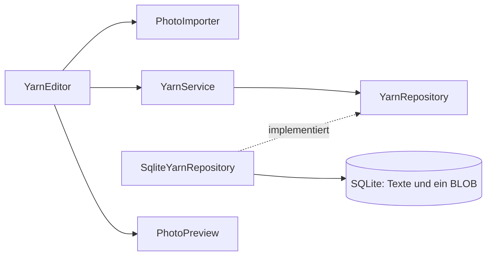

# Architektur und Bewerbungsgespräch

Yarn Box hat ein Maven-Modul und fünf kleine Bereiche. Die bewährten Muster von
BücherRegal wurden gezielt angepasst. Es gibt weder eine gemeinsame Bibliothek
noch eine Runtime-Abhängigkeit zwischen den beiden Apps.

| Bereich | Aufgabe |
| --- | --- |
| `domain` | Unveränderliche Records `Yarn`, `YarnDraft` und die Byte-Werteklasse `Photo` |
| `application` | Pflichtfeldverwendung, Suche, Speichervorgänge, Repository-Vertrag und Bildvalidierung |
| `persistence` | App-Datenpfad, Schema-Version, JDBC, atomare SQL-Anweisungen und Spracheinstellung |
| `i18n` | Unterstützte Sprachen, UTF-8-Kataloge und lokalisierte Zahlen |
| `ui` | JavaFX-Fenster, Entwurfszustand, Vorschau, Hintergrundaufgaben und Rückmeldungen |

`YarnsApplication` verbindet die Komponenten über Konstruktoren. Die
Anwendungslogik kennt weder JavaFX-Steuerelemente noch JDBC. `PhotoImporter`
nutzt die Standardbibliothek `java.desktop` für ImageIO, nicht JavaFX.
Die Pflichtfeldregel selbst sitzt im kompakten Konstruktor von `YarnDraft`.

## Farbauswahl und Sammlungsexport

`YarnColorField` hält die Farbauswahl im Editor. `YarnColors` übersetzt zwischen
JavaFX-Farben und stabilen sRGB-Hexwerten. Neue Auswahlen verwenden `#RRGGBB`
beziehungsweise `#RRGGBBAA` mit Alpha. Die bestehende SQLite-Textspalte `color`
bleibt erhalten. Dadurch benötigen alte Farbbeschreibungen keine automatische
Migration und bleiben beim Bearbeiten anderer Felder unverändert. Die Liste
zeigt für Hexwerte ein Farbfeld mit lesbarem Code. Das Entfernen einer Farbe
gehört wie jede andere Farbänderung zum gemeinsamen Verwerfschutz.

`CollectionExport` arbeitet mit `YarnRepository` und dem app-lokalen Port
`CollectionFile`. `JsonCollectionFile` schreibt UTF-8-JSON im Format
`yarn-box.collection`, Version 1. Die Anwendung lädt die vollständige gespeicherte
Sammlung unabhängig vom Suchfilter. Fotos werden je Eintrag nachgeladen, sodass
nicht alle Bilddaten gleichzeitig im Speicher liegen. Die UI sperrt während
des Exports konkurrierende Änderungen. Weitere gleichzeitig schreibende
App-Instanzen bleiben außerhalb des unterstützten Betriebs.

Die Datei enthält sämtliche Textfelder einschließlich des exakten Farbwertes
und ein optionales `photoBase64`. Ein temporäres Geschwister der Zieldatei nimmt
zunächst den vollständigen Inhalt auf. Erst danach wird die Datei ohne
Überschreiben eines vorhandenen Zieles verschoben. Fehler lassen die lokale
Sammlung unverändert.

`CollectionImport` ergänzt den Import über `CollectionImportRepository`.
`JsonCollectionFile` liest mit Gson im strikten Modus und übergibt jeden
geprüften Eintrag einzeln. Das vorhandene Format `yarn-box.collection`,
Version 1, bleibt unverändert. UTF-8, Feldtypen, eindeutige Schlüssel,
Vollständigkeit, Base64 und Bildinhalt werden geprüft. Datei und Eintragszahl
sind begrenzt. Es werden nicht alle Fotos gleichzeitig im Speicher gehalten.

Das SQLite-Repository führt den gesamten Leser innerhalb einer Transaktion
aus. Erst nach vollständiger Prüfung der Datei einschließlich ihres Endes
wird bestätigt. Identische Einträge werden anhand aller Texte und Fotobytes
abgeglichen. Ein Zähler pro Fingerabdruck erhält die Anzahl identischer Kopien
aus dem Export, ohne bei erneutem Import zusätzliche Kopien anzulegen. Die
neue Listenansicht wird aus derselben Transaktion geladen. Fehler führen zum
Rollback. Neue Einträge erhalten neue interne IDs. Sprache und Fotoordner
bleiben eigenständige lokale Einstellungen.

## Entscheidung: SQLite-Bilddaten

Ein nullable BLOB in derselben Tabellenzeile wie die Texte ist für genau ein
kleines Foto pro Eintrag einfach und zuverlässig. Eine einzige INSERT- oder
UPDATE-Anweisung schreibt alle Inhalte atomar. DELETE entfernt auch das Foto.
Es gibt keine unvollständigen Dateiverweise, Umbenennungen oder verwaisten Dateien.
Eine geschlossene Datenbankdatei genügt für eine manuelle Sicherung.

Separate Dateien könnten bei sehr großen Bildsammlungen sinnvoll sein, würden
hier aber temporäre Dateien, Fehlerbehandlung zwischen Dateisystem und Datenbank
sowie eine sichere Bereinigung verlangen. Diesen zusätzlichen Lebenszyklus
vermeidet Yarn Box bewusst. SQLite kann nach dem Entfernen von Bildern freien
Platz innerhalb der Datei behalten. Es wird keine automatische VACUUM-Funktion
oder sichere physische Datenlöschung versprochen.

## Ablauf: Eintrag mit Foto speichern

1. Der Editor hält Texte und das optionale `Photo` im Arbeitsspeicher. Beim
   Bearbeiten wird das gespeicherte Foto zuerst im Hintergrund geladen. Scheitert
   dies, öffnet sich kein Editor mit versehentlich leerem Foto.
2. Die native Dateiauswahl liefert nur einen Pfad. Abbrechen verändert nichts.
   `PhotoImporter.read` liest anschließend im Hintergrund höchstens 10 MiB plus
   ein Prüfbyte. Diese Begrenzung gilt auch, wenn die Datei nach der Größenprüfung
   gewachsen ist.
3. ImageIO erkennt das Format am Inhalt. Nur JPEG und PNG sind erlaubt.
   `ImageReader` prüft vor dem vollständigen Decodieren die Abmessungen.
   Die Grenzen sind 6000 Pixel je Seite und 16 Millionen Pixel insgesamt.
   Anschließend wird das Bild vollständig decodiert. Decoderfehler und Warnungen
   führen zur Ablehnung. Die Dateiendung ist nur ein Filter der Dateiauswahl.
4. Nur bei der Dateiauswahl erzeugt `PhotoOptimizer` aus dem decodierten Bild
   eine Kopie mit höchstens 1600 Pixeln an der längsten Seite. Bicubische
   Skalierung erhält die Proportionen und vergrößert kleine Bilder nicht.
   `PhotoOrientation` liest das begrenzte EXIF-Orientierungsfeld aus JPEG-APP1
   oder PNG-eXIf. Die acht Ausrichtungen einschließlich Spiegelungen werden
   vor der Ausgabe auf die Pixel angewendet. Tatsächlich transparente Bilder
   bleiben PNG, sonst wird JPEG mit Qualität 0,85 geschrieben. Die neue Datei
   übernimmt keine Quellmetadaten. Fehler erhalten den bisherigen Entwurf.
   Die JavaFX-Vorschau wird ebenfalls im Hintergrund decodiert und verkleinert.
   Erst wenn Import und Vorschau erfolgreich sind, ersetzen beide den bisherigen
   Fotoentwurf. Die Originaldatei bleibt unverändert. Es gibt keine Galerie.
   `PhotoImporter.decode` validiert bestehende Datenbankfotos und JSON-Fotos,
   ohne die Bytes neu zu codieren. Dadurch bleiben alte Sicherungen und die
   bytebasierte Erkennung identischer Kopien erhalten. Optimiert wird weder
   beim reinen Bearbeiten von Texten noch beim Export oder Wiederherstellen.
5. Speichern erstellt einen `YarnDraft`. Dessen Konstruktor prüft eine nicht
   leere Bezeichnung, auch bei Unicode-Leerraum. Einzeilige Texte werden außen
   bereinigt, Zeilenumbrüche und Formatierung der Notiz bleiben erhalten.
6. `YarnService.save` wählt anhand der internen ID zwischen Anlegen und Ändern.
   Der Hintergrund-Executor ruft das Repository auf. Ein `PreparedStatement`
   bindet fünf Texte und die Bildbytes. SQLite schreibt eine vollständige Zeile
   atomar. `try-with-resources` schließt Verbindung, Statement und Resultat auch
   bei Fehlern. Eine bestehende ID wird bei Bearbeitung beibehalten.
7. Erst nach dem erfolgreichen Abschluss aktualisiert der JavaFX-Callback die
   Liste und schließt den Dialog. Ein Fehler blendet die Meldung ein, ohne Texte
   oder Fotoentwurf zu löschen. Der Nutzer kann erneut speichern.

Abbrechen, Escape und Fensterschließen vergleichen Text- und Fotoentwurf mit
dem ursprünglichen Zustand. „Weiterbearbeiten“ ist die sichere Vorauswahl.
Während eines Imports oder Speicherns sind konkurrierende Dialogaktionen gesperrt.
Ein Entfernen wirkt zunächst nur auf den Entwurf. Kein App-Vorgang verändert
oder löscht die ausgewählte Quelldatei.

## Java-Kenntnisse gegenüber BücherRegal

| Bereits in BücherRegal | Konkret neu in Yarn Box |
| --- | --- |
| Records für Texte, stabile numerische IDs | Unveränderliche Byte-Werteklasse mit defensiven Kopien und inhaltsbasiertem `equals`/`hashCode` |
| JDBC für Textfelder | Nullable BLOBs und gemeinsame atomare Änderung von Text und Bild |
| Ressourcen sicher schließen | Begrenzte Streams, ImageIO-Reader, Decoderfreigabe und Bildprüfung vor großer Speicherbelegung |
| Hintergrundzugriffe auf SQLite | Hintergrundimport, Bilddecodierung und Vorschauerzeugung |
| Textentwurf und Abbruchschutz | Gemeinsamer Lebenszyklus von Texten und optionalem Foto |
| Temporäre Datenbanken im Test | Generierte JPEG-/PNG-Testbilder, Löschung der Quelle und Fehler während BLOB-Änderungen |

`Photo` kopiert Bytearrays an den Ein- und Ausgabegrenzen. Ein Aufrufer kann den
Entwurf nicht durch nachträgliche Arraymutation verändern. Der Importer ist der
Validierungseingang für ausgewählte und aus SQLite geladene Bilddaten.

Die Sammlung enthält nur leichte `Yarn`-Datensätze mit `hasPhoto`. BLOBs werden
für den ausgewählten Eintrag nachgeladen, nicht für die gesamte Liste. Ein
Generationszähler in `PhotoPreview` verhindert, dass ein älterer Callback nach
einem Auswahlwechsel ein falsches Foto anzeigt. Ein einzelner Executor hält
diesen kleinen Ablauf nachvollziehbar. Alle Änderungen an Steuerelementen laufen
über JavaFX-Task-Callbacks auf dem UI-Thread.

Die Suche arbeitet auf den bereits geladenen Texten. Unicode-Normalisierung
(NFC), `Locale.ROOT`, Streams und ein `Collator` der gewählten Sprache liefern reproduzierbare
Suche und Sortierung. Die interne ID unterscheidet gleichnamige Einträge.

## Grenzen und Quellen

Eine kleine lokale Sammlung ist das Ziel. Die Textsuche ist linear, es gibt
keine Synchronisation zwischen mehreren laufenden Instanzen. EXIF-Rotation und
Farbprofile werden nicht eigens aufbereitet. Windows- und macOS-Abnahmen sind
noch erforderlich, insbesondere mit Fotos von dort üblichen Quellen.

Die API-Entscheidungen wurden anhand der offiziellen Dokumentation geprüft:
[ImageReader in Java 21](https://docs.oracle.com/en/java/javase/21/docs/api/java.desktop/javax/imageio/ImageReader.html)
und [Image in JavaFX 21](https://openjfx.io/javadoc/21/javafx.graphics/javafx/scene/image/Image.html).

## Lokalisierung

`YarnsApplication.init` lädt die kleine Spracheinstellung vor dem UI-Start.
`Messages` bleibt für die Laufzeit eines Fensters unverändert. Dadurch passen
auch verzögerte Rückmeldungen zur sichtbaren Sprache. `StorageException` und
`PhotoException` transportieren stabile Codes. Erst `UiSupport` ordnet ihnen
den jeweiligen übersetzten Text zu. Technische Details werden nicht als rohe
Ausnahmemeldung in der Oberfläche angezeigt.

`LanguagePreferences` speichert die Wahl mit temporärer Datei und atomarem
Austausch im selben Datenverzeichnis. Es gibt keine Schema-Migration oder
Änderung von Foto-BLOBs. Das Paket enthält `jdk.localedata` für dieselbe
regionale Zahlendarstellung und Sortierung wie das Entwicklungs-JDK.
